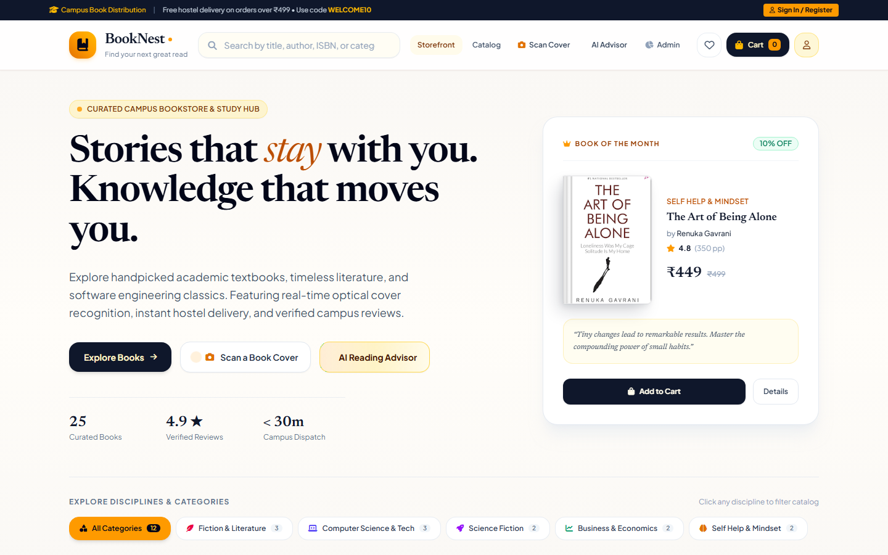
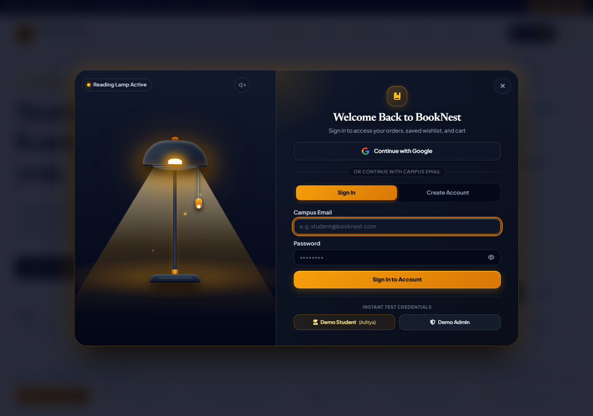
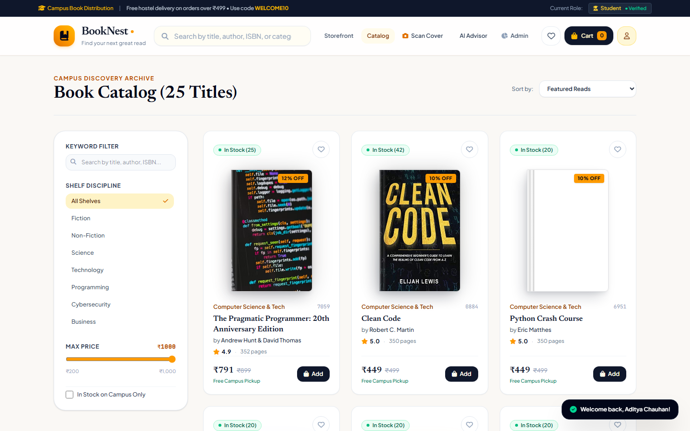
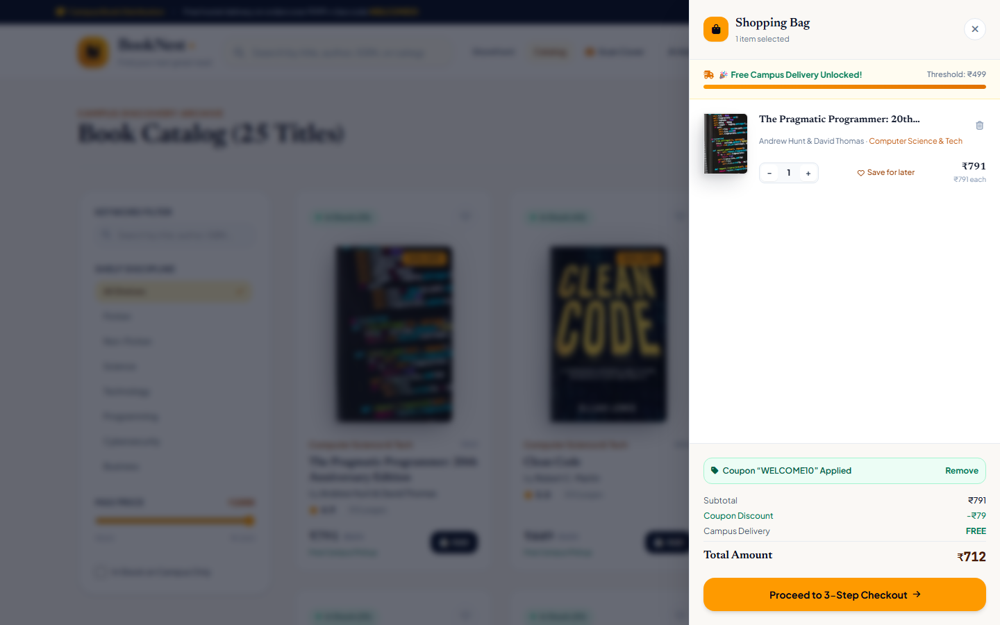
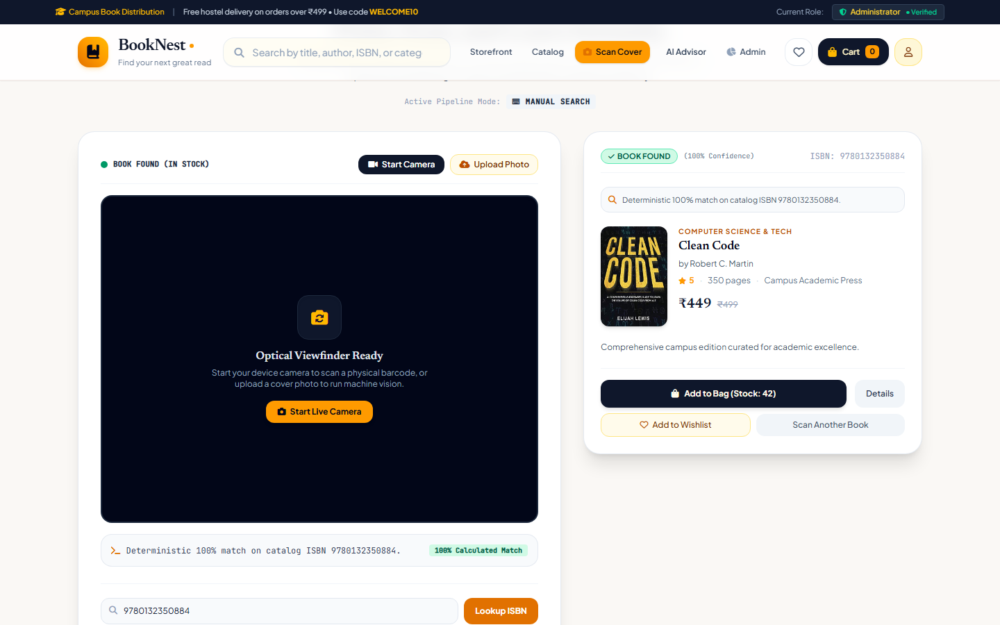
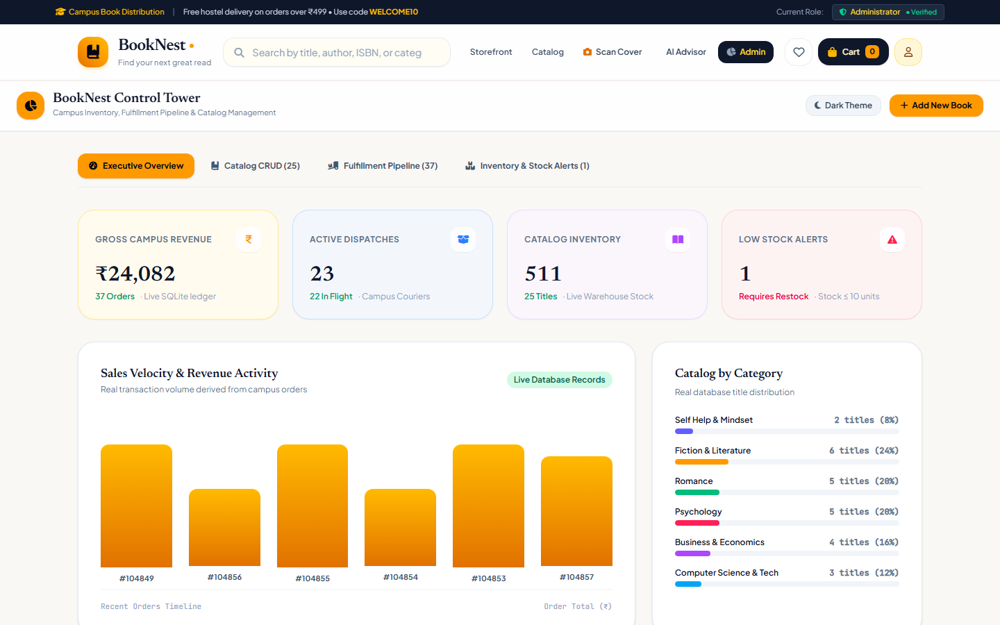

# 📚 BookNest — Academic Bookstore & Book Discovery Platform

[](.github/workflows/ci.yml)
[](tsconfig.json)
[](package.json)
[](vite.config.ts)
[](server/database/index.ts)
[-brightgreen?style=flat-square)](docs/development/testing.md)
[](scripts/test-a11y.mjs)

**BookNest** is a modern, full-stack academic bookstore and intelligent book discovery platform engineered for university campuses. It brings together high-performance catalog search, an optical ISBN and book cover camera scanner, Google Gemini generative AI reading recommendations, atomic inventory checkout, and an interactive dark glassmorphic lamp authentication experience.

Built with **React 19**, **TypeScript**, **Express**, and embedded **SQLite (WAL mode)**, BookNest delivers sub-millisecond response times, rock-solid order concurrency protection, and an accessible, mobile-first design.

---

## 🌟 Visual Showcase

| Storefront & Book Discovery | Interactive Lamp Login Experience |
|:---:|:---:|
|  |  |
| *Curated academic catalog with instant search & filters* | *Interactive pull-string lamp revealing dark glassmorphic auth* |

| Academic Catalog & Detail | Slide-Over Shopping Cart & Checkout |
|:---:|:---:|
|  |  |
| *Grid browsing with category tags and real-time inventory* | *Dynamic coupon discounts, item quantities & summary calculations* |

| Optical ISBN & Cover Camera Scanner | Administrator Operations & Inventory |
|:---:|:---:|
|  |  |
| *Real-time camera barcode scanner & Vision metadata lookup* | *Comprehensive sales metrics, stock adjustments & order dispatch* |

---

## 🚀 Key Features

- **📖 Academic Curriculum Catalogue**: Over 300 books categorized by Computer Science, Engineering, Mathematics, Business, Medical, Humanities, and General Reading.
- **🔍 Multi-Parametric Search & Filtering**: Real-time client and server filtering by keyword, curriculum subject, rating, price range, and publication date.
- **📷 Optical Barcode & Cover Scanner**:
  - Live browser camera video stream using native `BarcodeDetector` API.
  - Image upload support with client-side canvas downsampling.
  - Backend binary magic-byte inspection (supports JPEG, PNG, WebP) with 15MB payload tolerance.
  - Automatic fallback to Open Library catalog for books outside campus stock.
- **🤖 AI Reading Advisor**:
  - Powered by **Google Gemini 3.5 Flash Lite** for tailored academic reading recommendations.
  - Three-tier resilient fallback: Gemini API &rarr; Local Keyword Matcher &rarr; Verified Campus Warehouse Fallback.
  - Zero downtime even when API keys are unconfigured or external networks fail.
- **🪔 "Pull the Lamp to Reveal Login" Experience**:
  - Dark room cinematic atmosphere with ambient glow and realistic physics pull string.
  - Web Audio API acoustic pull and click synthesis with zero external audio assets.
  - Cohesive dark glassmorphism authentication card with ambient gold/amber illumination.
  - Full keyboard accessibility (Enter/Space toggles, Tab navigation, Escape key dismissal).
- **🛒 Dynamic Cart & Multi-Step Checkout**:
  - Persistent guest and user carts across browser sessions.
  - Coupon application engine (`WELCOME10` for 10% discount).
  - Multi-step checkout with order review, delivery details, and instant order generation.
- **🛡️ Enterprise Order Reliability & Idempotency**:
  - Atomic transactions (`BEGIN IMMEDIATE TRANSACTION`) guaranteeing zero overselling.
  - `Idempotency-Key` HTTP header deduplication preventing double-charges on network retries.
  - Safe status transitions (`Pending` &rarr; `Processing` &rarr; `Shipped` &rarr; `Delivered` &rarr; `Cancelled`) with automatic inventory restoration.
- **📊 Admin Operations Dashboard**:
  - Live revenue calculations, total orders, student registry, and low-stock alerts.
  - Book catalog management (create, update pricing/inventory, soft-delete archive).
  - Order fulfillment workflow and real-time status transitions.
- **♿ WCAG AA Accessibility Compliance**:
  - Skip-to-main-content keyboard links.
  - Global ARIA live regions for screen-reader announcements.
  - Complete focus traps in modals with Escape key dismissal and focus restoration.
  - `prefers-reduced-motion` responsive styling.

---

## 🛠️ Technology Stack

### Frontend Architecture
- **Framework**: [React 19](https://react.dev/) + [TypeScript 5.8](https://www.typescriptlang.org/)
- **Build Tool**: [Vite 8.3](https://vitejs.dev/) with Rolldown bundling
- **Styling**: [Tailwind CSS 3.4](https://tailwindcss.com/) + Custom Glassmorphism CSS Design Tokens
- **Icons & UI**: [Lucide React](https://lucide.dev/) + [FontAwesome 6](https://fontawesome.com/)
- **State Management**: Reactive custom hooks (`useAuth`, `useCart`) + Persistent Local Storage

### Backend Architecture
- **Runtime**: [Node.js](https://nodejs.org/) (ES Modules)
- **Web Framework**: [Express 4](https://expressjs.com/)
- **Database**: [SQLite](https://sqlite.org/) via `sqlite3` + Write-Ahead Logging (`WAL`)
- **Authentication**: Stateless JSON Web Tokens (`jsonwebtoken`) + `bcryptjs` password hashing
- **Security**: Strict payload limits (100KB standard, 15MB scanner), rate limiting, Helmet-style security headers, CORS origin verification
- **AI Integration**: [@google/genai SDK](https://www.npmjs.com/package/@google/genai) (Google Gemini 3.5 Flash Lite)

### Testing & Verification
- **Test Runner**: Native Node.js Test Harness
- **Browser Automation**: [Playwright](https://playwright.dev/) for headless end-to-end interaction testing
- **Linting & Types**: `tsc --noEmit` across entire monorepo

---

## 📁 Repository Structure

```text
book-nest/
├── .github/
│   ├── workflows/ci.yml             # GitHub Actions CI (Lint, Build, E2E)
│   ├── ISSUE_TEMPLATE/              # Bug report & feature request templates
│   └── PULL_REQUEST_TEMPLATE.md     # Standardized pull request template
├── docs/
│   ├── architecture/
│   │   ├── initial-audit.md         # Phase 0 baseline verification
│   │   ├── folder-structure.md      # Target architecture & migration map
│   │   ├── architecture.md          # System design & Mermaid diagrams
│   │   └── api-design.md            # Complete REST API specification
│   ├── development/
│   │   ├── setup.md                 # Local setup & prerequisites
│   │   ├── testing.md               # Test execution & verification guide
│   │   └── troubleshooting.md       # Port conflicts, SQLite locks & camera fixes
│   └── screenshots/                 # Curated application screenshots
├── data/
│   ├── booknest.db                  # Primary SQLite database (WAL mode)
│   └── booknest.test.db             # Isolated test database (auto-created)
├── server/
│   ├── config/                      # Environment validation & secrets management
│   ├── controllers/                 # Route handlers (auth, books, orders, etc.)
│   ├── database/                    # SQLite connection, schema & seed scripts
│   ├── errors/                      # Centralized AppError hierarchy
│   ├── middleware/                  # Security headers, CORS, rate limits, error handler
│   ├── routes/                      # Modular Express router endpoints
│   ├── services/                    # Gemini AI service & optical matcher
│   ├── validators/                  # Request payload validation & sanitization
│   └── server.ts                    # Express application entrypoint
├── src/
│   ├── components/
│   │   ├── common/                  # Reusable UI (ScreenReaderAnnouncer, etc.)
│   │   ├── layout/                  # Navigation bar & Editorial footer
│   │   ├── AnimatedLampLogin.tsx    # Interactive dark glassmorphic lamp login
│   │   ├── AdminDashboard.tsx       # Campus administration portal
│   │   ├── AIReadingAdvisor.tsx     # Gemini-powered recommendation modal
│   │   └── EditorialScannerView.tsx # Optical barcode/cover scanner view
│   ├── data/
│   │   ├── bookCatalog.ts           # Initial academic catalog dataset
│   │   └── categories.ts            # Curriculum categories & icons
│   ├── features/
│   │   └── books/                   # Domain views (StoreHomeView, CatalogView)
│   ├── hooks/                       # Custom React hooks (useAuth.ts)
│   ├── services/api/                # Modular domain API clients (auth, books, orders)
│   ├── styles/                      # Glassmorphism & lamp login styling
│   ├── types.ts                     # Core domain TypeScript models & contracts
│   ├── App.tsx                      # Root route coordinator & state manager
│   └── main.tsx                     # Application bootstrap
├── scripts/
│   ├── test-admin-auth.mjs          # Admin role & credential test suite (14 tests)
│   ├── test-animated-lamp-login.mjs # Interactive lamp login test suite (48 tests)
│   └── test-a11y.mjs                # Accessibility & keyboard navigation (38 tests)
├── .env.example                     # Safe environment template
├── CONTRIBUTING.md                  # Contributor workflow & guidelines
├── SECURITY.md                      # Vulnerability reporting & security model
└── package.json                     # Dependencies & build scripts
```

---

## ⚡ Getting Started

### 1. Prerequisites
- **Node.js**: v18.0.0 or later (v20+ recommended)
- **npm**: v9.0.0 or later

### 2. Installation
```bash
# Clone the repository
git clone https://github.com/guravneha246/book-nest.git
cd book-nest

# Install dependencies
npm install

# Setup environment variables
cp .env.example .env
```

### 3. Run Development Environment
```bash
npm run dev
```
- **Storefront URL**: `http://localhost:3000`
- **Backend API**: `http://localhost:5000`
- **API Health Check**: `http://localhost:5000/api/health`

### 4. Demo Accounts for Instant Testing
Click **"Sign In / Register"** in the navigation bar, pull the lamp string, and select a demo shortcut:
| Role | Email | Password | Permissions |
|:---|:---|:---|:---|
| **Demo Student** | `student@booknest.edu` | `student123` | Storefront browsing, cart, checkout, order history |
| **Demo Admin** | `admin@booknest.edu` | `admin123` | Full administrative inventory, sales metrics & dispatch |

---

## ⚙️ Environment Configuration

All environment variables are documented with safe placeholders in [`.env.example`](.env.example):

| Variable | Description | Default / Example | Required in Prod? |
|:---|:---|:---|:---:|
| `PORT` | Backend Express server port | `5000` | No |
| `APP_URL` | Frontend URL for redirects & CORS | `http://localhost:3000` | Yes |
| `JWT_SECRET` | Secret key for signing JWT tokens | *Auto-generated in dev* | **Yes (32+ chars)** |
| `GEMINI_API_KEY` | Google Gemini API key for AI Advisor | *Optional (has catalog fallback)* | No |
| `GOOGLE_CLIENT_ID` | Google OAuth Client ID for SSO | `""` | No |
| `GOOGLE_CLIENT_SECRET` | Google OAuth Client Secret | `""` | No |
| `DB_PATH` | Path override for SQLite database | `data/booknest.db` | No |
| `TRUST_PROXY` | Enable when deployed behind reverse proxy | `false` | When behind proxy |
| `AUTH_RATE_LIMIT_MAX` | Max login attempts per 15 min | `15` | No |
| `AI_RATE_LIMIT_MAX` | Max AI requests per 15 min | `20` | No |
| `SCANNER_RATE_LIMIT_MAX` | Max scanner lookups per 1 min | `30` | No |

---

## 📜 Available Scripts

| Command | Action |
|:---|:---|
| `npm run dev` | Concurrently starts Vite frontend (port 3000) and Express API (port 5000) |
| `npm run build` | Compiles and tree-shakes production assets to `dist/` |
| `npm run lint` | Executes TypeScript type checking (`tsc --noEmit`) across all files |
| `npm run test:e2e` | Runs complete backend E2E integration test battery (126 tests) |
| `npm run server` | Starts standalone Express API server |
| `node scripts/test-animated-lamp-login.mjs` | Runs Playwright browser suite for interactive lamp login (48 tests) |
| `node scripts/test-admin-auth.mjs` | Runs Playwright suite for admin authentication & RBAC (14 tests) |
| `node scripts/test-a11y.mjs` | Runs Playwright suite for WCAG accessibility compliance (38 tests) |

---

## 🧪 Testing & Quality Assurance

BookNest maintains an uncompromising standard of quality. Every critical user flow is validated:

```text
========================================================================
✔ TypeScript Linting & Static Typing (tsc --noEmit)        0 Errors
✔ Vite Production Build Compilation                        0 Errors
✔ Backend Integration & Concurrency Test Battery         126 Passed (0 failed)
✔ Interactive Animated Lamp Login Browser Suite           48 Passed (0 failed)
✔ Admin Authentication & Role Security Suite              14 Passed (0 failed)
✔ WCAG AA Accessibility & Focus Management Suite          38 Passed (0 failed)
========================================================================
TOTAL: 226 / 226 Tests Verified (100% Pass Rate)
```

Read more in the comprehensive [Testing Guide](docs/development/testing.md).

---

## 🔒 Security Policy

BookNest adheres to modern web application security principles:
- **Zero Secret Leakage**: No API keys, database credentials, or tokens are exposed in bundles or logs.
- **Strict Payload Guards**: Standard routes enforce a 100KB limit to prevent DDoS.
- **SQL Injection Immune**: Prepared parameterized statements used exclusively.
- **Idempotency Protection**: Duplicate order submissions are safely resolved without duplicate charges.

For vulnerability disclosure guidelines, review our [Security Policy](SECURITY.md).

---

## 🗺️ Engineering Roadmap

- [x] Full codebase modularization (UI, business services, API domain clients, error hierarchy).
- [x] Optical camera scanner with barcode decoding and Vision metadata fallback.
- [x] Gemini 3.5 Flash Lite AI Reading Advisor with resilient multi-tier fallback.
- [x] Dark glassmorphic animated lamp authentication experience.
- [x] Comprehensive automated test coverage (226 tests).
- [ ] Stripe Payment Gateway webhook integration for automated card settlement.
- [ ] Progressive Web App (PWA) offline service-worker caching for campus reading lists.
- [ ] Global dark mode toggle across the entire storefront.

---

## 🤝 Contributing

Contributions are welcome! Please read [CONTRIBUTING.md](CONTRIBUTING.md) for branch naming conventions, development guidelines, and testing requirements before submitting a pull request.

---

## 📄 License & Attribution

This project is currently maintained by the BookNest open-source team. For licensing terms and third-party dependency attributions, please refer to [THIRD_PARTY_LICENSES.md](docs/THIRD_PARTY_LICENSES.md).
