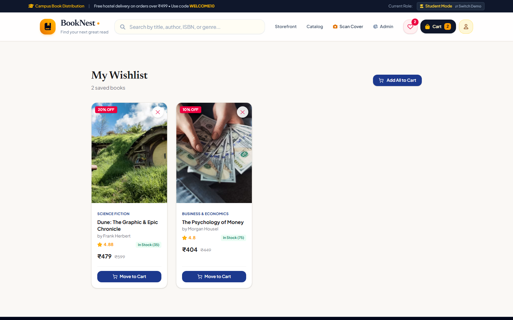
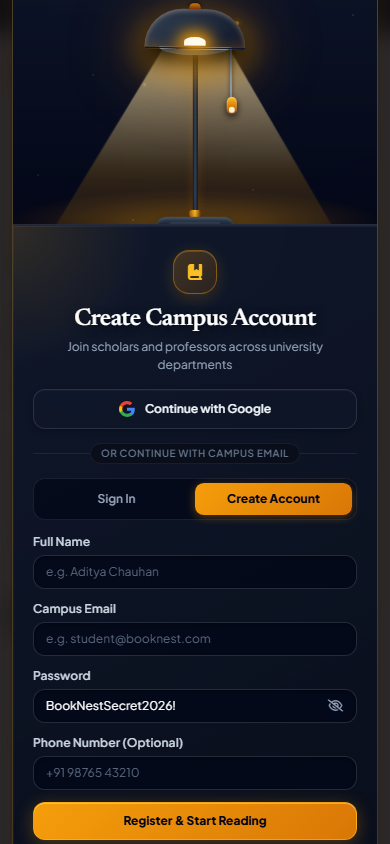
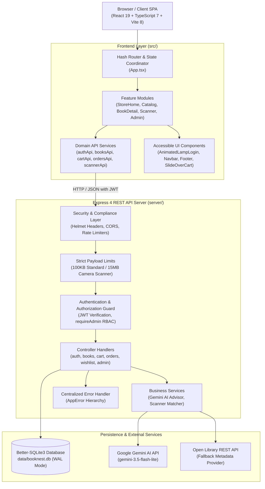

# 📚 BookNest — Full-Stack Academic Bookstore & Book Discovery Platform

[](https://github.com/guravneha246/book-nest/actions/workflows/ci.yml)
[](tsconfig.json)
[](package.json)
[](vite.config.ts)
[](server/server.ts)
[](server/database/index.ts)
[](package.json)
[](scripts/test-a11y.mjs)

**BookNest** is a full-stack academic bookstore and intelligent textbook discovery platform engineered specifically for university campuses. It brings together high-speed curriculum catalog search, an optical ISBN and book cover camera scanner, Google Gemini generative AI reading guidance, rock-solid atomic inventory checkout, and an interactive dark glassmorphic lamp authentication experience.

Engineered with **React 19**, **TypeScript 7**, **Express 4**, and **Better-SQLite3 (WAL mode)**, BookNest delivers sub-millisecond response times, zero overselling through atomic transactions, and an accessible, mobile-first design.

---

## ⚡ 30-Second Quick Start

Get BookNest up and running locally in three commands:

```bash
# 1. Clone the repository
git clone https://github.com/guravneha246/book-nest.git
cd book-nest

# 2. Install dependencies & initialize environment
npm install
cp .env.example .env

# 3. Start full-stack development (Vite on :3000 + Express on :5000)
npm run dev
```

* **Storefront UI**: [`http://localhost:3000`](http://localhost:3000)
* **Backend REST API**: [`http://localhost:5000/api`](http://localhost:5000/api)
* **API Health Check**: [`http://localhost:5000/api/health`](http://localhost:5000/api/health)

### 🔑 Instant Demo Accounts
Click **"Sign In / Register"** in the navigation bar, pull the lamp string, and select a demo shortcut (or enter manually):

| Role | Email | Password | Permissions & Scope |
|:---|:---|:---|:---|
| **Demo Student** | `user@booknest.com` | `User@123` | Storefront browsing, cart, checkout, order history, wishlist |
| **Demo Administrator** | `admin@booknest.com` | `Admin@123` | Full inventory management, sales metrics, order status dispatch |

---

## 📑 Table of Contents

- [Visual Showcase](#-visual-showcase)
- [Verified Feature Highlights](#-verified-feature-highlights)
- [System Architecture & Data Flow](#-system-architecture--data-flow)
- [Repository Structure](#-repository-structure)
- [Technology Stack](#-technology-stack)
- [Installation & Development Setup](#-installation--development-setup)
- [Database Architecture & Seeding](#-database-architecture--seeding)
- [Environment Configuration](#-environment-configuration)
- [Available npm Scripts](#-available-npm-scripts)
- [Testing & Quality Assurance](#-testing--quality-assurance)
- [Security & Concurrency Defenses](#-security--concurrency-defenses)
- [Documentation Hub](#-documentation-hub)
- [Contributing](#-contributing)
- [License & Attributions](#-license--attributions)

---

## 📸 Visual Showcase

| Storefront & Book Discovery | Interactive Lamp Login Experience |
|:---:|:---:|
|  |  |
| *Curated academic catalog with instant search & multi-category filters* | *Interactive pull-string lamp revealing dark glassmorphic auth modal* |

| Academic Catalog & Details | Slide-Over Shopping Cart & Checkout |
|:---:|:---:|
|  |  |
| *Grid browsing with category tags, price sorting & real-time inventory* | *Dynamic coupon discounts (`WELCOME10`), line items & tax calculations* |

| Optical ISBN & Cover Camera Scanner | Administrator Operations & Inventory |
|:---:|:---:|
|  |  |
| *Real-time camera barcode scanner & Open Library metadata lookup* | *Comprehensive sales metrics, stock adjustments & order dispatch* |

| Student Wishlist & Saved Books | Mobile Responsive Lamp Authentication |
|:---:|:---:|
|  |  |
| *Personal student wishlist with single or bulk "Add All to Cart"* | *Fluid touch-friendly pull-string interaction across all mobile viewports* |

---

## ✨ Verified Feature Highlights

### 📖 Academic Curriculum Catalog & Filtering
- **300+ Verified Academic Titles**: Structured across 19 university disciplines including Computer Science, Engineering, Mathematics, Business, Medical, Humanities, and General Reading.
- **Multi-Parametric Search & Sorting**: Real-time client and server filtering by keyword, curriculum category, star rating, price slider, and publication year.
- **Persistent Search Analytics**: Automatic recording of campus search trends and recent keyword history in SQLite.

### 📷 Optical Machine Vision ISBN & Cover Scanner
- **Native Browser Video Stream**: Direct live video stream utilizing the native `BarcodeDetector` API for zero-latency camera scanning.
- **Manual Image Upload & Downsampling**: Client-side canvas preprocessing with automatic aspect-ratio preservation.
- **Binary Magic-Byte Inspection**: Server-side binary inspection (JPEG, PNG, WebP) with strict 15MB payload tolerance.
- **Resilient External Fallback**: Automatically queries the Open Library API when a scanned textbook is not yet stocked in campus inventory.

### 🤖 Google Gemini AI Reading Advisor
- **Context-Aware Recommendations**: Powered by Google Gemini (`gemini-3.5-flash-lite`) to recommend tailored academic reading paths based on syllabus requirements.
- **Three-Tier Resilient Fallback Architecture**:
  1. Primary: Google Gemini Cloud API
  2. Secondary: Local Keyword & Discipline Intent Matcher
  3. Tertiary: Verified Top-Rated Campus Warehouse Inventory
- **Zero-Downtime Guarantee**: The storefront operates seamlessly even if API keys are unconfigured or external networks fail.

### 🪔 Interactive "Pull the Lamp" Authentication
- **Atmospheric Physics-Driven Interaction**: Quadratic Bezier SVG pull string with damped harmonic spring recoil physics.
- **Zero-Asset Web Audio Synthesis**: Procedural acoustic clicks, string tension, and electrical switch sounds generated dynamically via the Web Audio API without external audio files.
- **Dark Glassmorphic UI**: Ambient gold illumination reveal with smooth backdrop filtering and accessible focus containment.
- **Complete Keyboard & a11y Navigation**: Fully operable with `Enter`/`Space` pull toggles, `Escape` dismissal, and ARIA state announcements.

### 🛒 Dynamic Shopping Cart & Multi-Step Checkout
- **Synchronized Cart State**: Offline guest cart in `localStorage` automatically merges into authenticated SQLite user carts upon sign-in.
- **Coupon Validation Engine**: Promotional discounts (e.g., `WELCOME10` for 10% off) validated authoritatively on the backend.
- **Hostel Delivery Manifest**: 3-step checkout wizard capturing student hostel block, room number, phone, and payment method.
- **Printable GST Tax Invoices**: Formats printable official academic tax invoices directly via `window.print()`.

### 🛡️ Enterprise Order Reliability & Idempotency
- **Atomic Concurrency Protection**: Transactions execute inside SQLite `BEGIN IMMEDIATE TRANSACTION` blocks to guarantee zero stock overselling.
- **`Idempotency-Key` HTTP Header Support**: Deduplicates network retries to protect students from accidental double charges.
- **Managed Order Lifecycle**: Strict status transitions (`Confirmed` &rarr; `Processing` &rarr; `Dispatched` &rarr; `Delivered` &rarr; `Cancelled`) with automatic catalog stock restoration upon order cancellation.

### 📊 Campus Administrator Control Tower
- **Executive Revenue Metrics**: Real-time sales totals, average order value, order volume, and registered student counts.
- **Catalog Lifecycle Management**: Add new textbooks, adjust pricing, update real-time stock levels, or soft-delete archived titles.
- **Fulfillment Pipeline**: Transition student orders through delivery stages with immediate database persistence.

---

## 🏗️ System Architecture & Data Flow

BookNest adheres to a clean, decoupled client-server architecture:



For complete details on request lifecycles, database entity relationships, and sequence diagrams, refer to the [System Architecture Guide](docs/architecture/architecture.md).

---

## 🗂️ Repository Structure

```text
book-nest/
├── .github/
│   ├── workflows/
│   │   └── ci.yml                   # GitHub Actions CI workflow (lint, build, test:e2e)
│   ├── ISSUE_TEMPLATE/              # Structured bug report & feature request templates
│   └── PULL_REQUEST_TEMPLATE.md     # Standardized pull request quality checklist
├── docs/
│   ├── architecture/
│   │   ├── initial-audit.md         # Baseline assessment & health check
│   │   ├── folder-structure.md      # Target architectural breakdown & boundaries
│   │   ├── architecture.md          # System design & comprehensive Mermaid diagrams
│   │   └── api-design.md            # Complete REST API specification & schemas
│   ├── development/
│   │   ├── setup.md                 # Local developer onboarding guide
│   │   ├── testing.md               # Test execution & verification handbook
│   │   └── troubleshooting.md       # Diagnostics for port conflicts & file locks
│   ├── screenshots/                 # Curated genuine application screenshots
│   └── THIRD_PARTY_LICENSES.md      # Third-party attributions (Animated Lamp Login)
├── data/
│   ├── booknest.db                  # Embedded SQLite database (WAL mode)
│   ├── catalogue-seed-data.json     # Precompiled 300+ book catalogue fixtures
│   └── booknest.test.db             # Auto-generated isolated test database (gitignored)
├── server/
│   ├── config/                      # Environment loading, port parsing & safety guards
│   ├── controllers/                 # Route controllers (auth, books, cart, orders, admin)
│   ├── database/                    # SQLite connection, schema DDL, indexes & seeds
│   ├── errors/                      # Centralized AppError hierarchy
│   ├── middleware/                  # Security headers, CORS, rate limiters, error handler
│   ├── routes/                      # Modular Express router dispatchers
│   ├── services/                    # Google Gemini AI client & optical scanner matcher
│   ├── validators/                  # Request payload validation & sanitization
│   ├── index.ts                     # Standalone tsx server loader
│   └── server.ts                    # Express application bootstrap & route assembly
├── src/
│   ├── components/
│   │   ├── common/                  # Reusable accessible UI (ScreenReaderAnnouncer)
│   │   ├── layout/                  # Navbar, HeroSection, and Footer
│   │   ├── AnimatedLampLogin.tsx    # Interactive dark glassmorphic lamp login
│   │   ├── AdminDashboard.tsx       # Campus administration control tower
│   │   ├── AIReadingAdvisor.tsx     # Gemini-powered recommendation modal
│   │   └── EditorialScannerView.tsx # Camera video stream & barcode scanner
│   ├── data/
│   │   ├── bookCatalog.ts           # Initial baseline catalog fixtures
│   │   └── categories.ts            # 19 curriculum categories, colors & metadata
│   ├── features/
│   │   └── books/                   # Domain views (StoreHomeView, CatalogView)
│   ├── hooks/                       # Custom React hooks (useAuth.ts)
│   ├── services/api/                # Scoped domain API clients (auth, books, cart, orders)
│   ├── styles/                      # Design tokens, glassmorphism & lamp styling
│   ├── types.ts                     # TypeScript domain models & API response interfaces
│   ├── App.tsx                      # Root route coordinator & state orchestrator
│   └── main.tsx                     # Vite application bootstrap
├── scripts/
│   ├── test-admin-auth.mjs          # Playwright admin RBAC test suite (14 tests)
│   ├── test-animated-lamp-login.mjs # Playwright lamp physics & a11y suite (48 tests)
│   ├── test-a11y.mjs                # Playwright WCAG AA accessibility suite (38 tests)
│   ├── test-responsive-ux.mjs       # Viewport responsiveness suite (42 tests)
│   ├── test-persistence.mjs         # SQLite database CRUD persistence suite
│   ├── test-scanner.mjs             # Optical barcode decoding test suite
│   └── verify-all-fixes.mjs         # Backend integration & concurrency suite (126 tests)
├── .env.example                     # Sanitized environment template
├── CONTRIBUTING.md                  # Contributor workflow & guidelines
├── SECURITY.md                      # Vulnerability reporting & security model
├── package.json                     # Project dependencies & npm scripts
├── tsconfig.json                    # Strict TypeScript configuration
└── vite.config.ts                   # Vite configuration with API proxy
```

---

## 🛠️ Technology Stack

| Domain | Technology | Version | Purpose |
|:---|:---|:---:|:---|
| **Frontend Framework** | [React](https://react.dev/) | `^19.0.1` | Core declarative component UI library |
| **Language** | [TypeScript](https://www.typescriptlang.org/) | `^7.0.2` | Strict end-to-end type safety |
| **Build & Dev Tool** | [Vite](https://vitejs.dev/) | `^8.3.0` | High-speed ESM development server and bundler |
| **Styling** | [Tailwind CSS](https://tailwindcss.com/) | `^4.3.3` | Utility-first responsive styling via `@tailwindcss/vite` |
| **Icons** | [Lucide React](https://lucide.dev/) | `^0.546.0` | Accessible, consistent UI iconography |
| **Animations** | [Motion](https://motion.dev/) | `^12.23.24` | Smooth interactive animations and transitions |
| **Backend Runtime** | [Node.js](https://nodejs.org/) | `20.x` / `22.x` | Modern server-side ES Modules execution |
| **Server Framework** | [Express](https://expressjs.com/) | `^4.21.2` | Fast, unopinionated REST API routing |
| **Database** | [Better-SQLite3](https://github.com/WiseLibs/better-sqlite3) | `^13.0.3` | Synchronous, high-speed SQLite in WAL mode |
| **Authentication** | [jsonwebtoken](https://github.com/auth0/node-jsonwebtoken) | `^9.0.3` | Cryptographic JWT session issuance & verification |
| **Password Hashing** | [bcryptjs](https://github.com/dcodeIO/bcrypt.js) | `^3.0.3` | Adaptive salted password hashing |
| **AI Integration** | [@google/genai](https://www.npmjs.com/package/@google/genai) | `^2.4.0` | Official Google Gemini Generative AI SDK |
| **Browser Testing** | [Playwright](https://playwright.dev/) | `^1.63.0` | Headless browser automation for UI & a11y tests |
| **TypeScript Execution** | [tsx](https://github.com/privatenumber/tsx) | `^4.21.0` | Zero-config TypeScript watcher & runner for server |

---

## ⚙️ Installation & Development Setup

### 1. Prerequisites
- **Node.js**: `v20.x` or `v22.x` (minimum `v18.0.0`)
- **npm**: `v9.0.0` or later
- **Git**: `v2.30.0` or later

### 2. Step-by-Step Setup
```bash
# Clone the repository
git clone https://github.com/guravneha246/book-nest.git
cd book-nest

# Install dependencies
npm install

# Copy environment configuration
cp .env.example .env
```
*(On Windows PowerShell, use `Copy-Item .env.example .env`)*

### 3. Launch Development Environment
```bash
npm run dev
```

`npm run dev` concurrently launches:
1. **Frontend Client (Vite)** on `http://localhost:3000`
2. **Backend Server (Express)** on `http://localhost:5000`

The Vite dev server automatically proxies all `/api` requests to `http://localhost:5000`.

For a full step-by-step setup walkthrough, consult the [Local Development Guide](docs/development/setup.md).

---

## 🗄️ Database Architecture & Seeding

BookNest uses an embedded, zero-configuration SQLite database engine located at [`data/booknest.db`](data/booknest.db):

* **Write-Ahead Logging (`WAL`)**: Enabled on startup (`PRAGMA journal_mode = WAL`) to support concurrent reads alongside non-blocking writes.
* **Strict Foreign Keys**: Foreign key constraints are enforced (`PRAGMA foreign_keys = ON`) with cascading deletes on carts, wishlists, and order items.
* **Automatic Initialization**: On server startup, [`server/database/index.ts`](server/database/index.ts) executes schema DDL, runs non-destructive migrations, creates performance indexes, and seeds 300+ curriculum books, coupon codes, and demo accounts.
* **Test Isolation**: In `NODE_ENV=test`, the database path automatically redirects to `data/booknest.test.db`, and safety guards prevent tests from modifying `data/booknest.db`.

---

## ⚙️ Environment Configuration

All environment variables are configured with safe defaults in [`.env.example`](.env.example):

| Variable | Description | Default / Example | Required in Production? |
|:---|:---|:---|:---:|
| `PORT` | Backend Express server port | `5000` | No |
| `APP_URL` | Frontend URL for CORS verification & redirects | `http://localhost:3000` | **Yes** |
| `JWT_SECRET` | Secret key for signing session tokens (HMAC-SHA256) | *Dev fallback* | **Yes (32+ chars)** |
| `GEMINI_API_KEY` | Google Gemini API key for live AI recommendations | `""` (uses local fallback) | No |
| `GOOGLE_CLIENT_ID` | Google OAuth Client ID for SSO | `""` | No |
| `GOOGLE_CLIENT_SECRET` | Google OAuth Client Secret | `""` | No |
| `DB_PATH` | Path override for SQLite database file | `data/booknest.db` | No |
| `TRUST_PROXY` | Enable when deployed behind a reverse proxy | `false` | When behind proxy |
| `CORS_ALLOWED_ORIGINS` | Comma-separated list of allowed origins | `http://localhost:3000` | Recommended |
| `AUTH_RATE_LIMIT_MAX` | Max login attempts per 15-minute window | `15` | No |
| `AI_RATE_LIMIT_MAX` | Max AI recommendation requests per 15-minute window | `20` | No |
| `SCANNER_RATE_LIMIT_MAX` | Max optical scanner lookups per 1-minute window | `30` | No |

---

## 📜 Available npm Scripts

All scripts declared in [`package.json`](package.json):

| Command | Action & Description |
|:---|:---|
| `npm run dev` | Concurrently starts the Vite frontend (:3000) and Express backend (:5000) with watch mode |
| `npm run client` | Starts only the Vite development server on port 3000 |
| `npm run server` | Starts only the Express API server with `tsx watch server/index.ts` |
| `npm run build` | Compiles and tree-shakes production frontend assets into `dist/` |
| `npm run preview` | Locally serves the compiled production build from `dist/` |
| `npm run clean` | Deletes the `dist/` directory safely across operating systems |
| `npm run lint` | Runs TypeScript type checking (`tsc --noEmit`) across the entire repository |
| `npm run test:e2e` | Executes the complete backend integration and concurrency suite (126 tests) |
| `npm run test:scanner` | Executes optical scanner barcode decoding and MIME inspection tests |
| `npm run test:persistence` | Executes SQLite CRUD and WAL persistence validation tests |
| `npm run test:ui` | Runs headless Playwright browser audit on the active storefront |

### Standalone Browser Test Suites
*Ensure the development server is active on `http://localhost:3000` before running Playwright scripts:*

```bash
# Animated lamp login physics, audio synthesis & accessibility
node scripts/test-animated-lamp-login.mjs

# Admin authentication, credential security & RBAC protection
node scripts/test-admin-auth.mjs

# WCAG AA accessibility, skip links & focus containment
node scripts/test-a11y.mjs
```

---

## 🧪 Testing & Quality Assurance

BookNest enforces automated verification across static analysis, production builds, backend APIs, and browser interaction:

| Verification Suite | Target & Scope | Command | Outcome |
|:---|:---|:---|:---:|
| **Static Typecheck** | TypeScript validation across client and server | `npm run lint` | **0 Errors** |
| **Production Build** | Vite production compilation & asset bundling | `npm run build` | **0 Errors** |
| **Backend Integration** | API routing, transactions, auth, AI, scanner, CORS | `npm run test:e2e` | **126 / 126 Passed** |
| **Animated Lamp Login** | Lamp pull physics, audio synthesis, focus trap | `node scripts/test-animated-lamp-login.mjs` | **48 / 48 Passed** |
| **Admin Authentication** | Admin credential verification, JWT tampering, RBAC | `node scripts/test-admin-auth.mjs` | **14 / 14 Passed** |
| **Accessibility (WCAG)** | Skip links, ARIA live regions, focus containment | `node scripts/test-a11y.mjs` | **38 / 38 Passed** |
| **Overall Test Battery** | Complete regression and compliance coverage | All Suites | **226 / 226 Tests Verified (100% Pass Rate)** |

Read the [Testing & Quality Assurance Guide](docs/development/testing.md) for full execution options and safety flags.

---

## 🔒 Security & Concurrency Defenses

* **Defense-in-Depth Architecture**: Layered middleware enforces Helmet security headers (`X-Content-Type-Options: nosniff`, `X-Frame-Options: DENY`, `Referrer-Policy: strict-origin-when-cross-origin`), CORS origin validation, and rate limiting per endpoint category.
* **Strict Payload Boundaries**: Standard JSON routes enforce a strict 100KB limit to prevent memory exhaustion attacks. The optical scanner route allows up to 15MB for raw camera frames and validates image headers via binary magic bytes.
* **Zero Secret Leakage**: API tokens, JWT secrets, and database credentials are never bundled into client assets or printed in production logs.
* **SQL Injection Immunity**: 100% of database queries execute via prepared parameterized statements.
* **Atomic Checkout Guarantee**: Order placement executes within SQLite `BEGIN IMMEDIATE TRANSACTION` blocks, ensuring simultaneous checkouts for the last available copy safely decrement inventory without negative stock.
* **`Idempotency-Key` Protection**: Prevents duplicate order placement and double charges caused by network drops or impatient client retries.

For vulnerability disclosure guidelines, review our [Security Policy](SECURITY.md).

---

## 📚 Documentation Hub

| Document | Purpose |
|:---|:---|
| [System Architecture](docs/architecture/architecture.md) | High-level system design, layered boundaries, and sequence diagrams |
| [REST API Specification](docs/architecture/api-design.md) | Comprehensive endpoint catalog, request payloads, and status codes |
| [Folder Structure Guide](docs/architecture/folder-structure.md) | Detailed directory organization, file roles, and module boundaries |
| [Local Development Setup](docs/development/setup.md) | Step-by-step developer environment setup and credentials |
| [Testing & Quality Assurance](docs/development/testing.md) | Automated testing guide, Playwright runners, and test isolation |
| [Troubleshooting & Diagnostics](docs/development/troubleshooting.md) | Solutions for port conflicts, SQLite file locks, and camera permissions |
| [Contributing Guidelines](CONTRIBUTING.md) | Branching conventions, coding standards, and pull request checklist |
| [Security Policy](SECURITY.md) | Security vulnerability disclosure instructions and defense model |
| [Third-Party Attributions](docs/THIRD_PARTY_LICENSES.md) | Third-party open-source licenses and component attributions |

---

## 🤝 Contributing

Contributions are welcome! Please read [CONTRIBUTING.md](CONTRIBUTING.md) for branch naming conventions, development standards, and verification requirements before opening a pull request.

1. Fork the repository
2. Create your feature branch (`git checkout -b feature/amazing-feature`)
3. Validate your changes (`npm run lint && npm run build && npm run test:e2e`)
4. Commit your changes (`git commit -m 'feat: add amazing feature'`)
5. Push to the branch (`git push origin feature/amazing-feature`)
6. Open a Pull Request

---

## 📄 License & Attributions

BookNest is an open-source academic bookstore project.

Third-party component attributions and licenses:
* The interactive pull-string reading lamp animation is adapted from [Animated-Lamp-Login](https://github.com/saklincodes/Animated-Lamp-Login) by `saklincodes` under the **MIT License**. Detailed notice and license text are recorded in [THIRD_PARTY_LICENSES.md](docs/THIRD_PARTY_LICENSES.md).

*(Maintainers: To declare the root project license, see [Reported Maintainer Items](#missing-information--maintainer-decisions) below.)*
