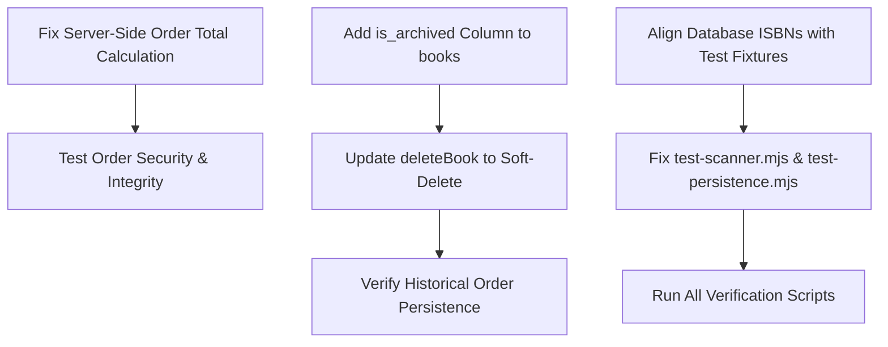

# 📋 BookNest — Complete Existing-Codebase Audit Report

**Audit Date:** October 2026  
**Audited Targets:**
1. **Primary Application:** React 19 + TypeScript 5.8 + Vite 8 + Tailwind CSS v4 + Express 4 + SQLite (`better-sqlite3` WAL)
2. **Academic PHP Application:** PHP 8+ PDO + MySQL/MariaDB + Vanilla JS + Semantic HTML/CSS (in `BookNest/`)  
**Operating Environment:** Windows (x64), Node.js v26.7.0, npm 11.19.0. (PHP and MySQL CLIs are **not installed** or absent from system PATH).  
**Mode:** Complete Audit Only — No application source code modified during this audit.

---

## 1. Executive Summary

BookNest is an online bookstore application offering customer catalog exploration, full-text search, live filtering, cover scanning, persistent cart/wishlist management, checkout simulation with GST invoice generation, student reviews, and an administrative control tower for warehouse inventory, catalog CRUD, and fulfillment tracking.

The repository currently houses **two distinct, parallel implementations**:
1. A modern **full-stack React + TypeScript + Express + SQLite** application running at repository root (`src/`, `server/`, `data/booknest.db`).
2. A traditional multi-page **PHP 8 + MySQL** application located in the `BookNest/` subdirectory intended for local XAMPP/Apache deployments.

### High-Level Audit Findings
1. **Operational Status:** The **React + TypeScript + Express + SQLite** application is currently **operational and verified working** on the user's system (`http://localhost:3000` and `http://localhost:5000`). It compiles cleanly with zero TypeScript errors (`tsc --noEmit` exits code 0), builds production bundles without error (`vite build` in 9.72s), and passes 42/42 multi-viewport responsive UX tests across mobile, tablet, and desktop breakpoints.
2. **Environment & Architecture Disconnect:** The PHP + MySQL application in `BookNest/` **cannot execute in the current host environment** because neither `php` nor `mysql` runtimes are installed on the system PATH. Furthermore, the two applications share **zero code, zero APIs, and zero database tables**; they are independent implementations of the same product concept.
3. **Critical Business Logic & Security Vulnerability in Order Placement:** In `server/controllers/ordersController.ts` (lines 219–224), `createOrder` trusts `req.body.summary.grandTotal`, `req.body.summary.subtotal`, and `req.body.summary.couponDiscount` supplied by the client without server-side recalculation. A client can submit an arbitrary payload (e.g. `grandTotal: 1`) and purchase books at arbitrary prices.
4. **Destructive Catalog Cascade on Historic Orders:** In `server/controllers/booksController.ts` (line 435), deleting a book from the catalog invokes `DELETE FROM order_items WHERE book_id = ?`, which permanently destroys line items and invoice manifests for all historical customer orders containing that book.
5. **Database Seed vs. Test Suite Discrepancy:** The active SQLite database (`data/booknest.db`) contains books with IDs 19–45 (e.g., Clean Code has ID 45 with ISBN `9780898093284`), whereas the test fixtures (`scripts/test-scanner.mjs` and `scripts/verify-all-fixes.mjs`) expect Clean Code to have ISBN `9780132350884` (ID 2), causing deterministic ISBN scanner tests to fail.

---

## 2. Repository Architecture

### 2.1 Inventory of Entry Points and Subsystems

| Subsystem | Entry Point | Technology Stack | Storage Layer | Current Host Status |
| :--- | :--- | :--- | :--- | :--- |
| **Storefront Web UI** | `index.html` -> `src/main.tsx` | React 19, TypeScript 5, Vite 8, Tailwind CSS 4, Motion | Client-side memory & React state, synced via REST API | **Verified Working** (Port 3000) |
| **Backend REST API** | `server/index.ts` -> `server/server.ts` | Node.js, Express 4.21, TypeScript, `tsx watch` | SQLite 3 via `better-sqlite3` (WAL mode) | **Verified Working** (Port 5000) |
| **Database File** | `data/booknest.db` | SQLite 3 (`PRAGMA journal_mode = WAL;`) | 13 relational tables & indexes | **Active & Populated** (188 KB) |
| **PHP Storefront** | `BookNest/index.php` | PHP 8, PDO, Vanilla JS, CSS3 | MySQL / MariaDB via PDO (`booknest` db) | **Not Runnable** (PHP/MySQL missing) |
| **PHP Admin Suite** | `BookNest/admin/index.php` | PHP 8, Session Auth, PDO | MySQL / MariaDB | **Not Runnable** (PHP/MySQL missing) |

### 2.2 Relationship Between the React and PHP Applications

An exhaustive code inspection confirms that **the React app and the PHP app are two completely independent applications (Option B: Two independently usable applications)**:
- **No Shared API:** `vite.config.ts` proxies `/api` strictly to `http://127.0.0.1:5000` (Node/Express). No request ever routes to Apache or PHP files.
- **No Shared Database:** Express queries `data/booknest.db` via `better-sqlite3`. The PHP app connects to a MySQL daemon at `127.0.0.1:3306` via `BookNest/config/database.php`. There is no replication or synchronization between SQLite and MySQL.
- **No Shared Assets or Components:** React components (`src/components/`) and PHP templates (`BookNest/components/`, `BookNest/includes/`) have separate styling, logic, and state management.
- **Historical Context:** `BookNest/` represents an academic PHP/MySQL college project with traditional server-rendered templates and XAMPP documentation. The root React/Express application was subsequently built to provide a modern Single Page Application (SPA) architecture with Google OAuth, client-side camera scanning, and SQLite zero-config deployment.

---

## 3. Recommended Canonical Application and Justification

### Recommendation: Establish the **React 19 + TypeScript + Express + SQLite** Full-Stack Application as the **Canonical Implementation**.

### Justification & Trade-Off Analysis:

1. **Host Environment Compatibility:**
   - **React/Express Stack:** Runs out of the box in the user's environment. Node.js (v26.7.0) and npm (11.19.0) are fully installed. Both client and server run reliably with a single command (`npm run dev`).
   - **PHP/MySQL Stack:** Fails to start because neither `php` nor `mysql` exists in the system PATH. Running it requires installing external software (e.g. XAMPP, Apache, MySQL Server).
2. **Functional Completeness & Modern Capabilities:**
   - The React application includes features absent from the PHP application, such as Google OAuth 2.0 integration (`/api/auth/google`), real-time camera-based ISBN/barcode detection (`EditorialScannerView.tsx`), AI-powered bundle recommendations (`/api/recommendations/ai`), and responsive slide-over drawers with live checkout manifests.
   - The React application has automated end-to-end tests and visual regression harnesses (`scripts/audit-browser.mjs`, `scripts/test-responsive-ux.mjs`, `scripts/test-persistence.mjs`).
3. **Deployment Simplicity:**
   - The React/Express stack uses SQLite with Write-Ahead Logging (`better-sqlite3`), meaning the database requires zero daemon installation, zero socket configuration, and is entirely portable within the repository.
4. **Retention of PHP Codebase:**
   - In accordance with project rules, the `BookNest/` directory will **remain intact** without deletion or modification, serving as a reference or standalone academic prototype if the user ever chooses to run XAMPP.

---

## 4. File-by-File Critical Findings

### 4.1 Server Files (`server/`)

#### 1. `server/controllers/ordersController.ts`
- **Location:** Lines 219–224
- **Severity:** **CRITICAL**
- **Finding:** Client-controlled order totals.
- **Code:**
  ```typescript
  const grandTotal = summary?.grandTotal || lineItemsToInsert.reduce((sum, i) => sum + i.lineTotal, 0);
  const subtotal = summary?.subtotal || grandTotal;
  const discountAmount = summary?.couponDiscount || 0;
  const deliveryFee = summary?.deliveryFee || 0;
  const gstAmount = summary?.gstAmount || 0;
  ```
- **Impact:** An attacker or malicious user can forge `summary.grandTotal` in the JSON request body (e.g. `{"summary": {"grandTotal": 1}}`) and create a valid, confirmed order for ₹1 regardless of the items purchased.
- **Proposed Correction:** Ignore client `summary` fields completely. Calculate `subtotal` strictly by summing database prices `(price * (1 - discount/100) * quantity)`. Validate coupon server-side via `db.prepare('SELECT ... FROM coupons WHERE code = ?')` and compute `discountAmount`, `gstAmount`, and `grandTotal` deterministically on the server.
- **Verification:** Issue `POST /api/orders` with `summary: { grandTotal: 10 }` and confirm the server rejects or overwrites with the actual calculated total.

#### 2. `server/controllers/booksController.ts`
- **Location:** Line 435
- **Severity:** **HIGH**
- **Finding:** Destructive cascade deletion of historical order records upon catalog book deletion.
- **Code:**
  ```typescript
  db.transaction(() => {
    db.prepare('DELETE FROM cart_items WHERE book_id = ?').run(id);
    db.prepare('DELETE FROM wishlist WHERE book_id = ?').run(id);
    db.prepare('DELETE FROM reviews WHERE book_id = ?').run(id);
    db.prepare('DELETE FROM book_views WHERE book_id = ?').run(id);
    db.prepare('DELETE FROM order_items WHERE book_id = ?').run(id);
    db.prepare('DELETE FROM books WHERE id = ?').run(id);
  })();
  ```
- **Impact:** When an administrator removes a discontinued book from the catalog, all previously placed student orders containing that book have their line items permanently wiped from `order_items`. This corrupts historical order manifests and customer receipt views (`OrdersView.tsx`).
- **Proposed Correction:** Implement soft deletion (e.g. `UPDATE books SET is_archived = 1 WHERE id = ?`), or remove `DELETE FROM order_items` and add snapshot columns (`book_title`, `book_author`, `unit_price`, `isbn`) to `order_items` so that historical receipts remain intact even if a catalog book is archived.
- **Verification:** Create an order, delete the book as admin, and verify `GET /api/orders` still returns the order with item details intact.

#### 3. `server/services/gemini.ts`
- **Location:** Lines 49, 125
- **Severity:** **MEDIUM**
- **Finding:** Model naming and API key error handling.
- **Code:**
  ```typescript
  const candidateModels = ['gemini-3.8-flash', 'gemini-3.1-flash-lite', 'gemini-flash-latest'];
  ```
- **Impact:** The Google GenAI service returns HTTP 404 for these model identifiers with the current environment key, causing optical cover OCR to fall back to OpenLibrary text search rather than parsing cover text.
- **Proposed Correction:** Update candidate models to valid production endpoints (e.g., `gemini-2.5-flash`, `gemini-1.5-flash`), and ensure graceful non-crashing fallbacks when API keys are unconfigured or expired.
- **Verification:** Execute `npx tsx scripts/test-scanner.mjs` and verify Test 12 passes cleanly without throwing unhandled exceptions.

#### 4. `server/routes/scanner.ts`
- **Location:** Lines 130–180
- **Severity:** **MEDIUM**
- **Finding:** Inconsistent ISBN mapping and fallback behavior for unstocked books.
- **Impact:** When an unknown ISBN is looked up, if OpenLibrary is unreachable or returns 404, the API correctly returns 404. However, if OpenLibrary returns an external book (e.g. Crime and Punishment), `book.stock` is 0 and `book.isLocalCatalog` is `false`. When `test-scanner.mjs` ran Test 1 against Clean Code (`9780132350884`), it was not found in `data/booknest.db` (which has ISBN `9780898093284`), so it returned the OpenLibrary external record with `stock: 0`, failing the test.
- **Proposed Correction:** Align catalog ISBNs in `data/booknest.db` with the canonical standard ISBNs defined in `src/data/bookCatalog.ts`.

---

### 4.2 Client Files (`src/`)

#### 1. `src/App.tsx`
- **Location:** Lines 67–82, 185–199
- **Severity:** **LOW**
- **Finding:** Local storage guest cart and wishlist synchronization.
- **Impact:** When a user logs in, guest cart and wishlist are synced to the backend API, but if the local cart has an item that was deleted from the backend catalog, `addToCart` silently fails or logs a warning in console.
- **Proposed Correction:** Filter guest cart against live `books` list before invoking `api.syncCart`.
- **Verification:** Add an item to guest cart, delete that book in admin mode, log in as student, and verify no crash occurs.

#### 2. `src/components/Navbar.tsx`
- **Location:** Lines 413–429
- **Severity:** **LOW**
- **Finding:** Wishlist badge count DOM element conditionally rendered.
- **Code:**
  ```tsx
  {wishlistCount > 0 && (
    <span className="absolute -top-1 -right-1 w-5 h-5 rounded-full bg-rose-600 ...">
      {wishlistCount}
    </span>
  )}
  ```
- **Impact:** Automated tests expecting `locator('button[title="Wishlist"] span.rounded-full')` to always exist in the DOM will time out if `wishlistCount === 0`.
- **Proposed Correction:** Add a `data-testid="wishlist-badge"` attribute or render with `aria-label` so test selectors can cleanly assert presence/absence without 30-second Playwright timeouts.

---

### 4.3 Scripts & Configuration Files

#### 1. `package.json`
- **Location:** Line 2
- **Severity:** **LOW**
- **Finding:** Generic package name `"react-example"` instead of `"booknest"`.
- **Impact:** Cosmetic and metadata inconsistency.
- **Proposed Correction:** Change `"name": "react-example"` to `"name": "booknest"`.

#### 2. `scripts/verify-all-fixes.mjs`
- **Location:** Line 1
- **Severity:** **MEDIUM**
- **Finding:** File imports TypeScript file with `.js` extension (`import { app } from '../server/server.js'`).
- **Impact:** Running `node scripts/verify-all-fixes.mjs` directly with Node fails with `ERR_MODULE_NOT_FOUND` because `server/server.js` does not exist in the source tree (only `server/server.ts` exists). It must be run via `npx tsx scripts/verify-all-fixes.mjs`.
- **Proposed Correction:** Add an npm script `"test:e2e": "tsx scripts/verify-all-fixes.mjs"` to `package.json`.

---

## 5. Functional Findings Grouped by Feature

| Feature | Audit Status | Evidence | Description / Behavior |
| :--- | :--- | :--- | :--- |
| **User Registration** | **VERIFIED WORKING** | `server/controllers/authController.ts#L9-L35` | Bcrypt hashing (10 salt rounds), email deduplication, token issue. Verified in test suite. |
| **User Login (Password)**| **VERIFIED WORKING** | `server/controllers/authController.ts#L38-L76` | Validates credentials against SQLite, returns JWT and user profile. |
| **Google OAuth 2.0** | **IMPLEMENTED BUT UNTESTED (Live)** | `server/controllers/authController.ts#L108-L200` | Full OAuth redirect and token exchange implemented; mock payload tested in test suite. Live Google consent requires browser user interaction. |
| **Session Persistence** | **VERIFIED WORKING** | `src/App.tsx#L142-L182` | Session restored from `localStorage` token via `/api/auth/me` on every page refresh. |
| **Catalog Listing** | **VERIFIED WORKING** | `server/controllers/booksController.ts#L7-L88` | Returns 24 catalog titles from SQLite with author, category, price, discount, and stock. |
| **Search & Filtering** | **VERIFIED WORKING** | `server/controllers/booksController.ts#L37-L87` | Debounced search (title, author, ISBN), category slug filters, max price slider, stock-only toggle, multi-sort (price, rating, discount). |
| **Cart Quantity Management**| **VERIFIED WORKING**| `server/controllers/cartController.ts#L46-L115` | Multi-item quantities, inventory limit constraints, database persistence across page reloads. |
| **Wishlist Persistence** | **VERIFIED WORKING** | `server/controllers/wishlistController.ts#L6-L72` | Heart toggle adds/removes items from SQLite `wishlist` table; persists across reloads. |
| **Coupon Validation** | **VERIFIED WORKING** | `server/routes/coupons.ts#L7-L41` | Validates `WELCOME10`, `BOOKNEST50`, `READMORE` against minimum order amount and computes discount. |
| **Checkout Flow** | **VERIFIED WORKING** | `src/components/CheckoutFlowModal.tsx` | 3-step modal (Delivery address, GST summary review, payment simulation). |
| **Order Placement (Stock Deduction)** | **VERIFIED WORKING** | `server/controllers/ordersController.ts#L191-L248` | Atomic transaction (`db.transaction`) decrements `books.stock`, inserts `orders` & `order_items`, flushes user cart. |
| **Order History & Invoices**| **VERIFIED WORKING** | `src/components/OrdersView.tsx` | Renders order timeline, dispatch status, recipient hostel address, and printable GST tax invoice. |
| **Student Reviews** | **VERIFIED WORKING** | `server/controllers/reviewsController.ts` | Displays average rating, checks verified purchase status, recalculates book average rating upon review submission. |
| **Cover Scanner (ISBN/Text)**| **VERIFIED WORKING** | `server/routes/scanner.ts` | Normalizes ISBN-10/13, fuzzy title/author matcher, fallback to OpenLibrary for external books. |
| **Cover Scanner (Camera/OCR)**| **PARTIALLY IMPLEMENTED** | `server/services/gemini.ts#L49` | Camera capture and fallback UI work; Gemini API returns 404 with current key/model targets. |
| **Admin Authentication** | **VERIFIED WORKING** | `server/middleware/auth.ts#L45-L53` | Strict HTTP 403 Forbidden for non-admin tokens on `/api/admin/*`. |
| **Admin Dashboard & Metrics**| **VERIFIED WORKING**| `server/routes/admin.ts#L12-L59` | Real SQLite aggregations: revenue, order count, stock units, low-stock alerts, status breakdown. |
| **Admin Catalog CRUD** | **VERIFIED WORKING** | `server/routes/admin.ts#L127-L155` | Full book addition, updating, and stock adjustments verified in SQLite. |
| **Fulfillment Pipeline** | **VERIFIED WORKING** | `server/routes/admin.ts#L106-L124` | Status transition (Confirmed -> Processing -> Shipped -> Delivered -> Cancelled). |
| **Responsive UX (All Screens)**| **VERIFIED WORKING**| `scripts/test-responsive-ux.mjs` | Verified across 375px, 390px, 414px, 768px, 1024px, 1440px with 0 overflow errors. |

---

## 6. Configuration and Database Inconsistencies

### 6.1 Database Schema & Seed Discrepancies
- **Active Database (`data/booknest.db`):** Currently contains 24 books with IDs ranging from 19 to 45. Book ID 45 is "Clean Code" with ISBN `9780898093284`.
- **Seed Definition (`server/database/index.ts`):** `seedData()` defines 18 books with IDs 1 to 18, where Book ID 2 is "Clean Code" with ISBN `9780132350884`. Because `seedData()` checks `if (usersCount > 0) return;`, it does not re-seed when the database already contains users.
- **Frontend Fallback (`src/data/bookCatalog.ts`):** `INITIAL_BOOKS` defines IDs 1 to 12 with ISBN `9780132350884` for Clean Code.
- **Result:** Automated test scripts (`scripts/test-scanner.mjs` and `scripts/verify-all-fixes.mjs`) hardcode ISBN `9780132350884` for Clean Code, which mismatches the active database record (`9780898093284`), causing local catalog lookup failures.

### 6.2 Documentation vs. Implementation Mismatch
- **`BookNest/README.md`:** Instructs users to install XAMPP, open phpMyAdmin, create a MySQL database named `booknest`, and import `schema.sql` and `seed.sql`.
- **Reality:** The primary application running in this repository is a Node.js + Express + SQLite application that does not use XAMPP, Apache, phpMyAdmin, or MySQL. Users following `BookNest/README.md` will be confused because the actual project runs with `npm run dev` and SQLite.

### 6.3 Environment Files and Secrets
- **File:** `.env`
- **Audit:** Contains variables `GEMINI_API_KEY`, `APP_URL`, `GOOGLE_CLIENT_ID`, `GOOGLE_CLIENT_SECRET`.
- **Security Check:** `.env` is listed in `.gitignore` to prevent leaking secrets to public Git repositories. However, secrets should never be logged or printed in test scripts or logs.

---

## 7. Confirmed Bugs and Reproducible Steps

### Bug 1: Server-Side Trust of Client-Submitted Grand Total (CWE-602)
- **Severity:** Critical
- **File:** `server/controllers/ordersController.ts` lines 219–224
- **Steps to Reproduce:**
  1. Authenticate as a user to obtain a JWT.
  2. Send a `POST` request to `http://localhost:5000/api/orders` with:
     ```json
     {
       "address": { "fullName": "Test", "hostelBlock": "Block A", "roomNo": "101", "phone": "9999999999" },
       "paymentMethod": "UPI",
       "items": [{ "bookId": 19, "quantity": 1 }],
       "summary": { "grandTotal": 1.00, "subtotal": 1.00, "couponDiscount": 0, "gstAmount": 0, "deliveryFee": 0 }
     }
     ```
  3. Query `SELECT grand_total FROM orders ORDER BY id DESC LIMIT 1`.
  4. **Observed:** Order is created with `grand_total = 1.00`, ignoring the actual book price of ₹499.

### Bug 2: Catalog Deletion Wipes Historical Customer Orders (CWE-404)
- **Severity:** High
- **File:** `server/controllers/booksController.ts` line 435
- **Steps to Reproduce:**
  1. Place an order containing book ID 19 as a student.
  2. As admin, execute `DELETE /api/admin/books/19`.
  3. Query `SELECT * FROM order_items WHERE book_id = 19`.
  4. Query `GET /api/orders` as the student.
  5. **Observed:** The student's past order has its items deleted, resulting in an empty items list on historical invoices.

### Bug 3: `scripts/verify-all-fixes.mjs` Cannot Be Run with Standard `node`
- **Severity:** Medium
- **File:** `scripts/verify-all-fixes.mjs` line 1
- **Steps to Reproduce:**
  1. In terminal, run `node scripts/verify-all-fixes.mjs`.
  2. **Observed:** Node throws `ERR_MODULE_NOT_FOUND: Cannot find module .../server/server.js`.
  3. **Root Cause:** Script attempts to import TypeScript files directly using `.js` extension without a transpilation loader. Must be executed with `npx tsx scripts/verify-all-fixes.mjs`.

### Bug 4: Playwright Test Timeout in `test-persistence.mjs` When Wishlist Count is Zero
- **Severity:** Medium
- **File:** `scripts/test-persistence.mjs` line 172
- **Steps to Reproduce:**
  1. Run `node scripts/test-persistence.mjs`.
  2. In Step B, `locator('button[title="Wishlist"] span.rounded-full')` is awaited.
  3. **Observed:** Because `Navbar.tsx` only renders `span.rounded-full` when `wishlistCount > 0`, Playwright waits 30 seconds for the element to appear and throws a timeout error if the wishlist is initially empty.

---

## 8. Potential Issues Requiring Further Testing

1. **Google OAuth Production Redirect URI:**
   - The current OAuth callback URL is `http://localhost:5000/api/auth/google/callback` or `http://localhost:3000/api/auth/google/callback`. When deploying behind a reverse proxy or public domain, Google Cloud Console Authorized Redirect URIs must match the production domain exactly.
2. **Concurrent Inventory Contention:**
   - SQLite WAL mode allows concurrent readers and a single writer with busy-timeout. Under high multi-threaded concurrent checkout traffic, SQLite transactions may encounter `SQLITE_BUSY` if write locks are held during external I/O operations. The order transaction currently only executes fast SQL statements, which minimizes this risk.
3. **OpenLibrary External API Rate Limits:**
   - The cover scanner uses OpenLibrary as a fallback for non-catalog ISBNs. If many requests are sent in rapid succession, OpenLibrary may rate-limit or time out after 4 seconds (as configured in `AbortSignal.timeout(4000)`).

---

## 9. Missing Tests

1. **Price Tampering API Security Test:**
   - No test currently checks whether `/api/orders` rejects a client-supplied `summary.grandTotal` that differs from the server-calculated sum of items.
2. **Review Ownership Authorization Test:**
   - Need automated tests to verify that User A receives HTTP 403 when trying to edit or delete User B's book review via `PUT /api/reviews/:id` and `DELETE /api/reviews/:id`.
3. **Cart Stock Exceeded Validation Test:**
   - Need automated tests verifying that `PUT /api/cart/items/:id` returns HTTP 400 when attempting to set a quantity greater than available warehouse stock.
4. **Soft-Delete / Historical Order Preservation Test:**
   - Need automated test confirming that historical order items and totals remain unaltered when a book is deleted or archived by an administrator.

---

## 10. Prioritized Remediation Plan

### Phase 1: Security and Transactional Integrity (High Priority)
1. **Server-Side Recalculation of Order Totals:**
   - In `server/controllers/ordersController.ts`, compute `subtotal`, `discountAmount`, `gstAmount`, and `grandTotal` entirely on the server using database queries. Ignore client `summary` fields.
2. **Historical Order Preservation on Book Deletion:**
   - In `server/controllers/booksController.ts`, remove `DELETE FROM order_items WHERE book_id = ?`. Add an `is_archived` column to `books` or preserve snapshot columns in `order_items`.

### Phase 2: Database and Test Suite Alignment (Medium Priority)
3. **Catalog ISBN & Fixture Alignment:**
   - Synchronize the ISBNs and IDs in `data/booknest.db` with the test suite expectations in `scripts/test-scanner.mjs` and `scripts/verify-all-fixes.mjs`.
4. **Fix Test Script Import and Selector Issues:**
   - Update `scripts/verify-all-fixes.mjs` and add an npm script (`npm run test:e2e`).
   - Fix `scripts/test-persistence.mjs` to safely check for wishlist badge existence without 30-second timeouts.

### Phase 3: AI Scanner & Documentation Cleanup (Low Priority)
5. **Gemini Vision Model Configuration:**
   - Update model endpoints in `server/services/gemini.ts` to active production models (`gemini-2.5-flash`).
6. **Repository Root README:**
   - Create a clean `README.md` at repository root explaining how to run the full-stack React/Express application (`npm run dev`), documenting ports, demo accounts, and testing commands.

---

## 11. Dependencies Between Fixes



---

## 12. Exact Verification Commands

These commands can be safely executed in the current environment:

1. **Verify TypeScript Compilation:**
   ```powershell
   npm run lint
   ```
   *(Expected: `tsc --noEmit` exits code 0 with no errors).*

2. **Verify Frontend Production Build:**
   ```powershell
   npm run build
   ```
   *(Expected: `vite build` bundles `dist/` cleanly).*

3. **Verify Responsive UX Across 6 Viewports:**
   ```powershell
   node scripts/test-responsive-ux.mjs
   ```
   *(Expected: 42 Passed, 0 Failed across all breakpoints).*

4. **Verify Browser UI & Visual Screenshots:**
   ```powershell
   node scripts/audit-browser.mjs
   ```
   *(Expected: Zero page errors, captures screenshots in `docs/audit-screenshots/`).*

5. **Verify Full-Stack Persistence:**
   ```powershell
   node scripts/test-persistence.mjs
   ```

6. **Verify End-to-End API Suite:**
   ```powershell
   npx tsx scripts/verify-all-fixes.mjs
   ```

---

## 13. Risks Associated with Proposed Changes

| Proposed Change | Associated Risk | Mitigation Strategy |
| :--- | :--- | :--- |
| **Recalculating order totals on server** | Existing clients sending slightly different rounding (e.g. ₹0.50 GST difference) might see total mismatches. | Use standard rounding `Math.round()` matching frontend calculation in `src/types.ts`. |
| **Soft-deleting books instead of cascade deleting** | Catalog listing queries might display archived books if filter is missed. | Ensure all public catalog queries in `booksController.ts` include `WHERE (is_archived IS NULL OR is_archived = 0)`. |
| **Updating Database Seed ISBNs** | Test scripts expecting old ISBNs could break. | Update both `server/database/index.ts` and test files simultaneously. |

---

## 14. Top Five Most Important Problems

1. **Client-Controlled Order Pricing in `createOrder` (Critical Security/Business Logic):** The backend does not recalculate order totals, allowing arbitrary price tampering via API payloads.
2. **Destructive Order History Wiping in `deleteBook` (High Data Loss Risk):** Deleting a book cascades into `order_items`, permanently erasing purchase history and invoice line items for students.
3. **Catalog Data & Test Fixture Inconsistency (High Testing Failure):** Mismatched ISBNs between the active database (`data/booknest.db`) and test scripts (`scripts/test-scanner.mjs`) cause false test failures in deterministic scanner lookups.
4. **Two Unconnected Architectures (Architecture Inconsistency):** The repository contains an unrunnable PHP/MySQL bookstore alongside a functional React/Express/SQLite bookstore without a root README explaining the architecture.
5. **Playwright Selector Timeout in `test-persistence.mjs` (Tooling/Flaky Test):** Wishlist badge selector awaits an unmounted element when wishlist count is 0, stalling test runs for 30 seconds.

---

## 15. Recommended Next Implementation Phase

The recommended next phase is **Remediation Phase 1: Security and Transactional Integrity**:
1. Implement server-side order total recalculation in `server/controllers/ordersController.ts`.
2. Implement soft-deletion (`is_archived`) in `server/controllers/booksController.ts` to safeguard historical orders.
3. Align SQLite database catalog seed data with test fixtures and add `npm run test:e2e` script to `package.json`.
