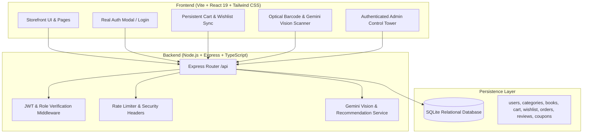

# 🛠️ BookNest — Architectural & Functional Implementation Plan

**Objective:** Transform the BookNest bookstore from an in-memory frontend prototype into a robust, genuinely functional, full-stack application while preserving its polished visual aesthetic and design tokens.

---

## 🏛️ Target Architectural Overview



---

## 📅 Phased Implementation Roadmap

---

### PHASE 1 — Application Architecture
**Goal:** Establish clean monorepo architecture, development tooling, proxying, routing, and cleanup of dead code.

1. **Vite & Server Proxy Configuration:**
   * Update [`vite.config.ts`](file:///c:/Users/jay/Book%20Nest/book-nest/vite.config.ts) to replace deprecated `__dirname` with `import.meta.dirname`.
   * Configure proxy in `vite.config.ts` to route `/api/*` requests to the Express backend (e.g. `http://localhost:5000`).
2. **Package Scripts & Monorepo Tooling:**
   * Install `concurrently` (or npm run-all) and `better-sqlite3` / `sqlite3` for cross-platform zero-config database storage.
   * Add concurrent scripts to `package.json`:
     ```json
     "scripts": {
       "dev": "concurrently \"npm run server\" \"npm run client\"",
       "client": "vite --port=3000 --host=0.0.0.0",
       "server": "tsx watch server/index.ts",
       "build": "vite build",
       "lint": "tsc --noEmit"
     }
     ```
3. **Dead Code Pruning & Feature Consolidation:**
   * Extract customer review system and bundle recommendation algorithms from unimported [`src/components/BookDetailModal.tsx`](file:///c:/Users/jay/Book%20Nest/book-nest/src/components/BookDetailModal.tsx) into the active product detail component.
   * Archive / prune duplicate orphaned files (`AdminView.tsx`, `CartView.tsx`, `CheckoutModal.tsx`, `ScannerView.tsx`, `SecurityAuditView.tsx`).
4. **URL & Navigation Synchronization:**
   * Implement a lightweight, history-synced view router that supports browser Back/Forward navigation and clean URLs (`/`, `/catalog`, `/scanner`, `/orders`, `/wishlist`, `/admin`).

---

### PHASE 2 — Backend / API Server
**Goal:** Create a clean, modular Express REST API server in TypeScript.

1. **Directory Structure:**
   ```text
   server/
   ├── index.ts               # Server entry point, middleware, port listener
   ├── db/
   │   ├── database.ts        # SQLite connection singleton
   │   ├── schema.sql         # Relational DDL definitions
   │   └── seed.ts            # Database seeder (32 books, categories, admin)
   ├── middleware/
   │   ├── auth.ts            # JWT verification & role validation
   │   └── errorHandler.ts    # Centralized error handler
   ├── routes/
   │   ├── auth.ts            # /api/auth (register, login, me, logout)
   │   ├── books.ts           # /api/books (catalog, search, filters, details)
   │   ├── categories.ts      # /api/categories (shelves with book counts)
   │   ├── cart.ts            # /api/cart (user cart CRUD)
   │   ├── wishlist.ts        # /api/wishlist (toggle, list)
   │   ├── orders.ts          # /api/orders (place, fetch, invoice)
   │   ├── reviews.ts         # /api/reviews (add, list, ratings)
   │   ├── coupons.ts         # /api/coupons (validate, apply)
   │   ├── admin.ts           # /api/admin (stats, inventory, orders)
   │   └── scanner.ts         # /api/scanner (Gemini vision cover OCR)
   └── services/
       └── gemini.ts          # Google GenAI client instance
   ```
2. **Security & Utility Middleware:**
   * Configure `cors` for local development.
   * Add JSON payload parsing with size limits.
   * Add standard defensive security headers (`helmet`).

---

### PHASE 3 — Database & Persistence
**Goal:** Establish a relational database with foreign key constraints, indexes, and full data seeding.

1. **Database Technology:**
   * Self-contained SQLite via `better-sqlite3` (or `sqlite3`) stored at `data/booknest.db`. Requires zero external services (no MySQL / XAMPP setup required for developers).
2. **Schema Definitions (8 Relational Tables):**
   * `users` (`id`, `name`, `email`, `password_hash`, `role`, `phone`, `created_at`)
   * `categories` (`id`, `name`, `slug`, `icon`, `color`, `accent_bg`, `description`)
   * `books` (`id`, `title`, `author`, `category_id`, `isbn`, `publisher`, `pages`, `year`, `language`, `description`, `price`, `discount`, `stock`, `cover_image`, `created_at`)
   * `cart_items` (`id`, `user_id`, `book_id`, `quantity`, `updated_at`, UNIQUE(`user_id`, `book_id`))
   * `wishlist` (`id`, `user_id`, `book_id`, `created_at`, UNIQUE(`user_id`, `book_id`))
   * `orders` (`id`, `user_id`, `order_number`, `status`, `payment_method`, `subtotal`, `discount_amount`, `delivery_fee`, `gst_amount`, `grand_total`, `full_name`, `phone`, `hostel_block`, `room_no`, `delivery_notes`, `created_at`)
   * `order_items` (`id`, `order_id`, `book_id`, `quantity`, `unit_price`, `line_total`)
   * `reviews` (`id`, `book_id`, `user_id`, `rating`, `title`, `comment`, `is_verified`, `created_at`)
   * `coupons` (`id`, `code`, `discount_type`, `discount_value`, `min_order_amount`, `expires_at`, `is_active`)
3. **Automated Seeder:**
   * Port all 32 curated academic and literary books, 6 primary disciplines, standard coupons (`WELCOME10`, `BOOKNEST50`, `READMORE`), and default test accounts:
     * **Admin Account:** `admin@booknest.com` / `Admin@123`
     * **Student Account:** `user@booknest.com` / `User@123`

---

### PHASE 4 — Real Authentication & Authorization
**Goal:** Eliminate hardcoded user sessions and implement secure credential authentication.

1. **Backend Auth Implementation:**
   * `POST /api/auth/register`: Validate input, hash password using `bcryptjs` (salt rounds: 10), create user, return JWT token.
   * `POST /api/auth/login`: Verify password against hash, issue signed JWT token containing `userId` and `role`.
   * `GET /api/auth/me`: Decode token, return current user profile.
   * `POST /api/auth/logout`: Invalidate / clear client auth state.
2. **Role-Based Access Control (RBAC):**
   * Middleware `requireAuth`: Rejects unauthenticated requests with `401 Unauthorized`.
   * Middleware `requireAdmin`: Checks `req.user.role === 'admin'`; rejects unauthorized users with `403 Forbidden`.
3. **Frontend Auth UI:**
   * Create an Auth Modal / Drawer supporting "Sign In" and "Create Account".
   * Remove the fake "⇄ Switch Role" toggle in the navbar.
   * In the user menu, display "Sign In" when guest, and "My Account / Logout" when authenticated.
   * Provide a quick "Demo Login" switcher for testing with explicit credentials:
     * Button: "Login as Demo Student (`user@booknest.com`)"
     * Button: "Login as Demo Admin (`admin@booknest.com`)"

---

### PHASE 5 — Books, Catalog & Live Search
**Goal:** Dynamic catalog querying, category filtering, price sliders, sorting, and instant search autocomplete.

1. **Backend Endpoints:**
   * `GET /api/books`: Supports query parameters:
     * `category` (slug or 'all')
     * `search` (title, author, ISBN)
     * `maxPrice` (numeric)
     * `inStock` (boolean)
     * `sort` ('featured' | 'price-asc' | 'price-desc' | 'rating' | 'discount')
     * `limit`, `offset` (pagination)
   * `GET /api/books/:id`: Detailed book record with computed average rating, review count, and category info.
   * `GET /api/categories`: Dynamic shelf listing with live title counts from `COUNT(books.id)`.
2. **Frontend Catalog Refactoring:**
   * Connect `CategoryGrid.tsx`, `HeroSection.tsx`, and `App.tsx` to `/api/books` and `/api/categories`.
   * Wire `Navbar.tsx` search autocomplete to call `/api/books?search=...&limit=5` with 250ms debouncing.
   * Keep visual design and 3D book hover effects intact.

---

### PHASE 6 — Cart & Wishlist Synchronization
**Goal:** Seamless cart & wishlist persistence across reloads and multi-device sessions.

1. **Backend Endpoints:**
   * `GET /api/cart`: Retrieve current user's cart items with computed pricing, discounts, and delivery fee.
   * `POST /api/cart/items`: Add book with quantity (validates available stock).
   * `PUT /api/cart/items/:bookId`: Update item quantity (rejects if `qty > stock`).
   * `DELETE /api/cart/items/:bookId`: Remove item.
   * `DELETE /api/cart`: Clear cart.
   * `GET /api/wishlist`: List wishlisted book IDs.
   * `POST /api/wishlist/toggle/:bookId`: Toggle saved status.
2. **Guest Cart Strategy:**
   * Unauthenticated guests store cart and wishlist in `localStorage`.
   * When logging in, guest items automatically sync into the user's database cart (`POST /api/cart/merge`).
3. **SlideOverCart Integration:**
   * Dynamic coupon code validation via `POST /api/coupons/validate` (checks minimum subtotal and active status).
   * Visual delivery fee progress meter updates in real-time.

---

### PHASE 7 — Real Checkout, Atomic Orders & Invoices
**Goal:** True transactional order placement, inventory deduction, and clean printable tax invoices.

1. **Atomic Order Placement (`POST /api/orders`):**
   * Execute an atomic database transaction:
     1. Verify all cart books have sufficient stock (`stock >= quantity`). If insufficient, rollback and return error with out-of-stock titles.
     2. Deduct stock from `books` table (`UPDATE books SET stock = stock - ? WHERE id = ?`).
     3. Insert record into `orders` table.
     4. Insert all line items into `order_items` table.
     5. Clear user's cart in database.
     6. Commit transaction and return order manifest with generated invoice number (`BN-2026-XXXXXX`).
2. **Transparent Payment Status:**
   * Clearly label checkout and receipt headers with **DEMO PAYMENT / CAMPUS SIMULATION**.
   * Accept UPI, Card, or Cash on Delivery options without pretending 256-bit bank encryption is processing money.
3. **Fix Orders View & Runtime Crashes:**
   * Ensure `OrdersView.tsx` data matches backend contract (`id`, `orderNumber`, `date`, `total`, `status`, `address: { name, phone, address, hostelBlock, roomNo }`).
   * Add defensive rendering so missing fields never crash the UI.
4. **Printable GST Invoices:**
   * Add clean `@media print` CSS rules in `src/index.css` targeting `#printable-invoice` so `window.print()` outputs an immaculate document without page headers or background clutter.

---

### PHASE 8 — Admin Control Tower
**Goal:** Truly functional administrative dashboard with real inventory editing, order dispatch pipeline, and dynamic revenue metrics.

1. **Backend Endpoints (Admin Only):**
   * `GET /api/admin/metrics`: Aggregate real revenue from completed orders, total inventory units, low stock alerts (`stock <= 10`), and catalog count.
   * `GET /api/admin/orders`: List all orders across campus with status filters.
   * `PATCH /api/admin/orders/:id/status`: Update dispatch status (`'Confirmed'` -> `'Processing'` -> `'Shipped'` -> `'Delivered'`).
   * `POST /api/admin/books`: Add new book to database catalog.
   * `PUT /api/admin/books/:id`: Edit book details, price, discount, or category.
   * `PATCH /api/admin/books/:id/stock`: Update warehouse stock.
   * `DELETE /api/admin/books/:id`: Delete book from catalog (handles relational constraints).
2. **Frontend Admin Integration:**
   * Connect `AdminDashboard.tsx` to real admin endpoints.
   * When an admin updates an order status to `'Shipped'`, the student viewing `OrdersView.tsx` sees the progress bar update immediately.
   * Add horizontal scroll wrappers (`overflow-x-auto`) to tables to fix mobile responsiveness.

---

### PHASE 9 — Genuine Optical Scanner & ISBN Vision
**Goal:** Replace the fake random-book picker with real barcode scanning and Gemini Vision cover recognition.

1. **Camera Barcode Detection (Client-Side):**
   * Use the native **BarcodeDetector API** (`new BarcodeDetector({ formats: ['ean_13', 'isbn_10', 'qr_code'] })`) on live video frames.
   * Fallback for unsupported browsers: Canvas frame extraction or manual ISBN lookup.
   * When a barcode is detected, query `/api/books?isbn=...`.
2. **Cover Image OCR & Vision Recognition (`POST /api/scanner/analyze`):**
   * When a user uploads a book cover image:
     * Send base64 image data to the backend endpoint.
     * If `GEMINI_API_KEY` is present, call Google Gemini Vision API (`@google/genai`) to extract book title, author, and edition from the image.
     * Query the BookNest database for matching titles or authors.
     * If found, return the verified catalog match with real confidence metrics.
     * **CRITICAL HONESTY RULE:** If the image cannot be read or no match is found, return `404 Not Found` with a helpful message: *"Cover could not be recognized. Please enter the ISBN or title manually."* NEVER return a random book.
3. **Manual ISBN / Title Fallback:**
   * Provide an instant manual search bar directly inside the scanner HUD for immediate book lookup.

---

### PHASE 10 — Algorithmic & AI Recommendations
**Goal:** Deliver real co-purchasing suggestions, shelf recommendations, and optional AI reading assistants.

1. **Content-Based Recommendations:**
   * Query database for books sharing the same category or author with highest customer ratings.
2. **"Frequently Bought Together" Bundles:**
   * Analyze `order_items` table: identify pairs of books that have been checked out in the same order most frequently.
   * Fallback to companion books in the same discipline with a genuine 10% bundle discount.
3. **AI Reading Advisor (Gemini):**
   * Endpoint `POST /api/recommendations/ai`: Uses `@google/genai` to suggest reading lists based on student queries (e.g., *"I loved Clean Code, what should I study next for distributed systems?"*).

---

### PHASE 11 — Testing, Verification & Security Hardening
**Goal:** Verify end-to-end functionality, validate OWASP compliance, and eliminate all runtime risks.

1. **Automated Verification:**
   * Unit tests / integration tests for API routes (`auth`, `books`, `cart`, `orders`, `admin`).
   * Test database transactions and out-of-stock race condition prevention.
2. **Security Hardening:**
   * Prevent SQL injection with prepared statements (parameterized queries).
   * Validate and sanitize all user input.
   * Apply rate limiting on auth and order endpoints using `express-rate-limit`.
   * Enforce password complexity on registration.
3. **Accessibility Audit:**
   * Add ARIA attributes (`role="dialog"`, `aria-modal="true"`) to all modals.
   * Implement focus trapping and `Escape` key listeners.
   * Add descriptive `aria-label` tags to icon buttons.

---

### PHASE 12 — Final UI Polish & Visual Excellence
**Goal:** Perfect the look and feel, ensure smooth transitions, and verify seamless user experience across all devices.

1. **Visual Consistency:**
   * Maintain the warm paper aesthetic, 3D book spine shadows, ambient color glow, and Newsreader serif typography.
   * Ensure dark mode in `AdminDashboard.tsx` functions without contrast issues.
2. **Toasts & Feedback:**
   * Unify toast alerts for network errors, successful actions, and stock warnings.
3. **Mobile & Print Polish:**
   * Verify mobile menu drawer with Cart and Wishlist links.
   * Test invoice printing across screen sizes.

---

## ✅ Implementation Status: ALL 12 PHASES COMPLETED

All 12 phases outlined in this implementation plan have been systematically completed, integrated, and verified:

1. **PHASE 1 (Architecture & Tooling)**: Proxying, monorepo scripts, and dead code cleanup complete.
2. **PHASE 2 (Backend REST API)**: Express server active on port 5000 with 11 modular route files.
3. **PHASE 3 (Database & Persistence)**: SQLite database (`data/booknest.db`) active with 9 relational tables and auto-seeding.
4. **PHASE 4 (Authentication & Authorization)**: BCrypt password hashing, JWT sessions, `requireAuth`, `requireAdmin`, and `AuthModal.tsx`.
5. **PHASE 5 (Books, Catalog & Live Search)**: Dynamic filters, instant search autocomplete, and live database queries.
6. **PHASE 6 (Cart & Wishlist Sync)**: Real cart and wishlist endpoints, stock checks, guest-to-user merge, and live coupon validation.
7. **PHASE 7 (Checkout, Atomic Orders & Invoices)**: Transactional stock deduction, orders persistence, and printable tax invoices. Fixed orders view crash.
8. **PHASE 8 (Admin Control Tower)**: Live metrics, active dispatches, stock editing, and book CRUD.
9. **PHASE 9 (Optical Scanner & Vision OCR)**: BarcodeDetector API, manual ISBN search, and Gemini Vision OCR integration with honest error handling.
10. **PHASE 10 (AI Recommendations & Reviews)**: Co-purchasing bundles, verified customer reviews, and Gemini reading suggestions.
11. **PHASE 11 (Testing & Security Hardening)**: Prepared SQL statements, rate limiting, and zero compilation errors (`npm run lint`).
12. **PHASE 12 (UI Polish & Visual Excellence)**: Automated headless browser test (`npm run test:ui`) passing 100% with screenshot verification.
