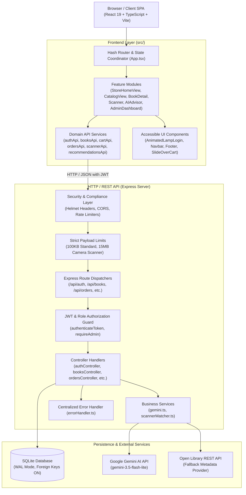
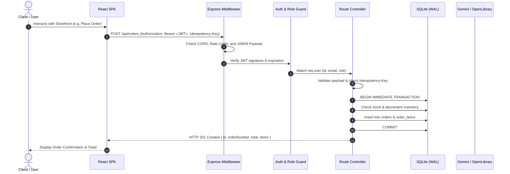
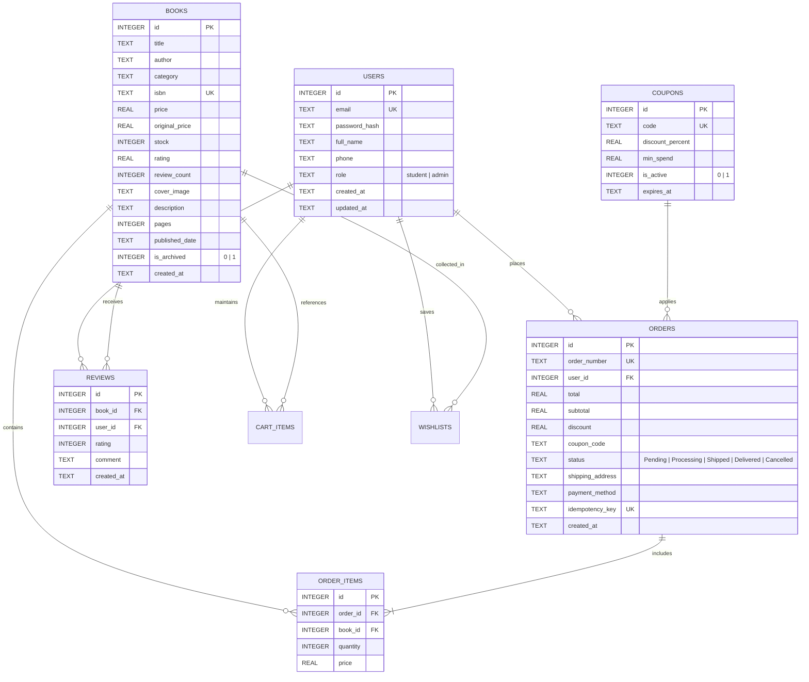

# BookNest — System Architecture & Design

This document details the high-level architecture, module boundaries, database schema, security model, and data flow of the BookNest academic bookstore application.

---

## 1. High-Level Architecture Overview

BookNest uses a decoupled client-server architecture:
- **Frontend**: Single-Page Application (SPA) built with React 19, TypeScript, and Vite, featuring Tailwind CSS utility styling, modular feature views, and dedicated API domain clients.
- **Backend**: RESTful API service built with Node.js and Express in ESM mode, structured around controllers, services, repositories/database layer, custom middleware, and a unified error hierarchy.
- **Data Layer**: Embedded SQLite database (`data/booknest.db`) operating with Write-Ahead Logging (`WAL`), strict foreign keys (`PRAGMA foreign_keys = ON`), and in-memory test isolation (`data/booknest.test.db`).

---

## 2. Request Lifecycle & Layered Boundaries

Every incoming HTTP request traverses a clean, deterministic pipeline:

---

## 3. Database Schema & Entity-Relationship Diagram

The SQLite schema enforces data integrity through foreign keys, unique constraints, and transaction boundaries.

---

## 4. Key Architectural Safeguards

### 4.1 Order Reliability & Concurrency Protection
1. **Atomic SQLite Transactions**: All checkout operations run inside `BEGIN IMMEDIATE TRANSACTION` blocks. If any book is out of stock, the entire order is aborted without inventory leakage.
2. **Idempotency Keys**: Clients send an `Idempotency-Key` header with checkout requests. Duplicate requests return the original response with an `Idempotent-Replayed: true` header without charging the user or decrementing stock twice.
3. **Safe Inventory Restoration**: When an order is marked `Cancelled`, inventory is incremented back. Repeated cancellations are idempotent and never double-restore stock.

### 4.2 Security Architecture
1. **Defense in Depth**: Frontend client validation is complemented by strict server-side validation. The backend is the sole authority for book prices, coupon calculation, inventory levels, and role privileges.
2. **Payload Protection**: Standard routes enforce a strict `100KB` body limit to eliminate resource exhaustion attacks. Only the optical scanner endpoint accepts up to `15MB` for high-resolution camera feeds.
3. **Rate Limiting**: Multi-window rate limiters defend `/api/auth` (15 req/15min), `/api/scanner` (30 req/min), and `/api/recommendations` (20 req/15min) against brute force and DDoS.
4. **JWT Hardening**: In production, `JWT_SECRET` is strictly validated to ensure minimum length (32 chars) and reject default strings.

### 4.3 AI Recommendation Resilience
The `/api/recommendations` endpoint employs a 3-tier fallback architecture:
1. **Tier 1 (Live AI Model)**: Google Gemini `gemini-3.5-flash-lite` provides personalized natural language recommendations.
2. **Tier 2 (Keyword Local Match)**: If the Gemini API key is unconfigured, expired, or unreachable, an intelligent fuzzy matching service ranks local campus books matching user query keywords.
3. **Tier 3 (Catalog Fallback)**: If no keyword matches, the service returns verified top-rated, in-stock campus inventory, ensuring the user always receives a valid, high-quality reading list.
